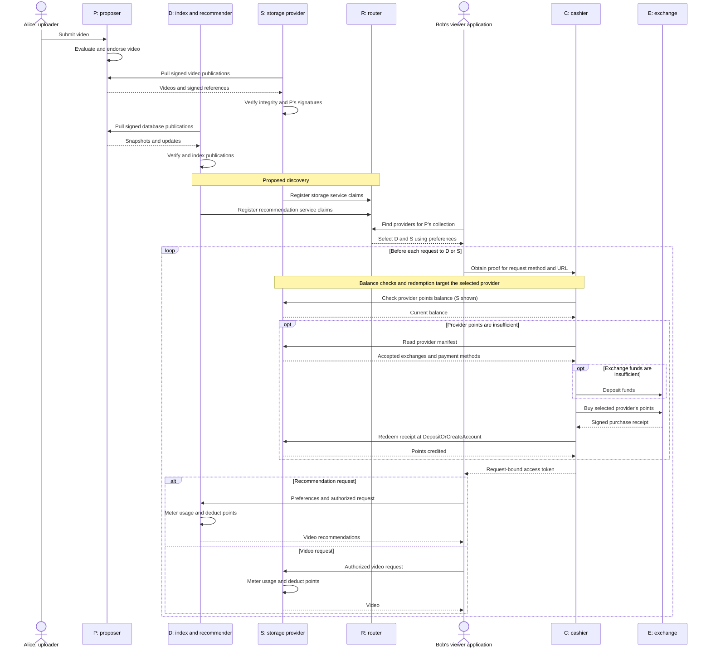

# Example: a video application with independent providers

> [!NOTE]
>
> This page describes the shape of PAID services application.
> - Some are implemented: storage provider, exchange, cashier
> - Some are designed and defined but not implemented because they are business dependent: proposer, viewer, recommender
> - Some are under development: index, router
> - Some are exploratory: observer, auction to guide global deployment

Consider a video streaming application. Alice uploads a video that Bob and Charlie will watch. They are all end users. To demonstrate the tradeoff of utility versus privacy, we assume Bob is utility focused while Charlie is privacy focused. An example interaction of a PAID system for it is as follows:

- Proposer (P): Video streaming platfrom P acts as proposer advertises itself. P needs to run a service to accept uploads. P also keeps a database of videos it finds valuable to serve with metadata for auditing, recommendation or other product usages.
- Uploader (Alice): Alice heards of P and requests to upload her video to P for public viewing. P evaluates the content and finds it valuable. P includes it into its video database.
- Storage provider (S): S wants to increase its download deals and heard of P being a popular video platform. It pulls P's video pull and enables open downloading service to users. Pulling with an OCI application will verify P's signatures to protect data integrity.
- Index (D): D heards of P too and pulls and verifies P's database and feeds to its search engine with metadata for recommendation.
- Router (R): Router resolves providers. S and D register themselves on router R that they serve P's contents as storage and recommender. R collect reviews of them in terms of their reputation for honesty, reliabilty and service quality like geographical latency.
- Viewer (Bob): Bob installed P's mobile application for videos. It asks R who serves P's contents. R looks up its list of recommender and storage providers and picks D and S for Bob according to its geographical location (or other preferences if it discloses). Bob uploads preference to D for video recommendation. D returns a list of videos with Alice's one. Bob downloads it from S and views.
- Observer (O): Viewer Charlie wants to view video too but is afraid of malicious service providers taking his money without serving proper contents or serve with poor quality like high network latency. He asks to proxy through O who will audit the connection and report to R if the service provider misbehaves or downgrades quality. The delegation can be opaque to O with confidentiality. But S cannot distinguish the request is from a user or O's monitoring request.
- Exchange (E): All above parties may change on exhange E. For example when Bob uses S's storage, Bob will transfer money to S on E for a quota token JWT. Bob sends it to S's `DepositOrCreateAccount()` endpoint to activate quota on S, which will be metered based on Bob's usage and the dynamic price at that time controlled by S. Money on E comes from Bob's deposit from a payment platform like Stripe or a blockchain. S can withdraw money from E after reception.
- Cashier (C): Manual management of payments for each request is tedious. Bob chooses a cashier provider and transfers $10 for his monthly budget to it. Whenever Bob requests, C will fulfill the request by buying points from a provider. It is application's responsibility to be budget-aware and plan for Bob's usage. Bob may set a budget for each application for a period of time. Bob can set usage caps per request. He may starve when out of budget. Charlie would run his own cashier for privacy.

Below is an illustration of Alice and Bob's flow. Charlie is similar to Bob but runs its own services. Observer is omitted because it is exploratory yet.

## PAID services allow various adaptations according to business requirements.

Proposer: P may choose to host every service itself the traditional way or decouple and outsource parts to PAID parties.
- P may choose to host videos itself or outsource to a storage provider, including both the temporary storage before its evaluation and at serving stage to viewers.
- P may run its upload reception service 24 hours or outsource to a message queue to a storage provider with redis streams. Then process uploads in batches. This can be desirable if P has a poor network or self-hosts with a personal laptop that may disconnect from time to time.
- P is free to choose content control strategies. P may refuse spam or inappropriate contents to support moderation. P may choose traditional account based moderation or support anonymous upload and prevent abuse by requiring Alice to pay for its content moderation fee, which may involve machine learning models or human evaluation, which may be provided by PAID parties too.
- P may decide retention of contents. Content serving by application providers and storage providers is driven by the market. A small, fresh and popular video list will encourage them to serve because content users are willing to purchase to view. Cold contents can be served too if proposer or someone else is willing to pay for the storage and application hosting, which can be seen as a form of advertisement. Auctions may be adopted for market efficiency and popularity discovery. A possible mechanism is to sell shares revenue of the next day publicly.
- P may support various products like hosting comments of the video in its database.

Application provider: The most basic form of application providers is proxying. They buy contents from storage providers and serve to users.
- Application providers may profit by displaying advertisements the traditional way and cover the storage fee incurred themselves. They may adopt the same protection as traditional video websites like a WAF or reCAPTCHA.
- Recommender systems may be adopted.
- For users with privacy needs, they may skip the 3rd party application provider and access storage providers directly by using a frontend with payment ability and application logic baked in, which may include recommender and s3 access logic.

User:
- Initial application: Bob may download P's mobile application or web page with similar logic by asking R for a proper storage provider and download.

Observer:
- Auditor: Per R's request, O will act as a monitoring 3rd party to important service providers by making mock requests from inconspisuous IP addresses to test if they behave honestly or hold high service quality.
