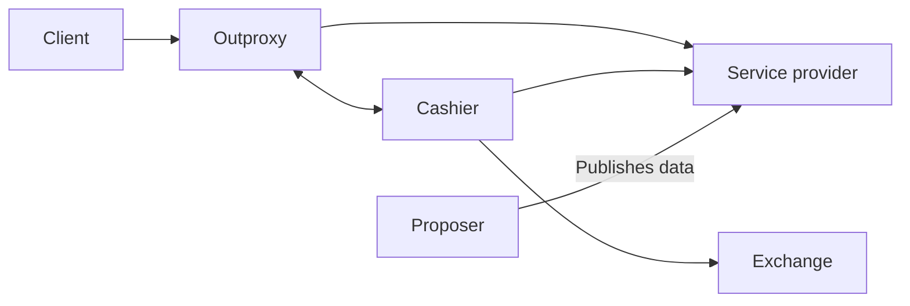

# Overview: how PAID services fit together

PAID is a pattern for applications whose data, infrastructure, and user experience can be provided by different parties. Participants pay for metered resource usage, giving independent providers a way to cover the costs of serving them.

PAID stands for **Permissionless, Autonomous, Incentivized, and Decoupled**. These are design goals: allow key-based participation, sustain services through usage revenue, reward providers, and make compatible services independently replaceable.

## Start with a familiar application

Consider a video application. One party selects and publishes a collection of videos. Other parties can store copies and serve them. An application presents the collection to viewers and may use a separate recommender. The viewer or the application pays for the resources consumed.

One operator can perform all these roles. PAID makes it possible to separate them without requiring each provider to operate the entire application.

## The roles and concepts

| Role or concept | Responsibility | Learn more |
| --- | --- | --- |
| User | Chooses an application and consumes services, paying directly or through an application funded by subscriptions, advertisements, or sponsors | [Application](./application.md) |
| Functionality | Describes the desired API behavior, data, and service requirements independently of a provider | [Functionality](./functionality.md) |
| Proposer | Defines and publishes data that others can serve | [Proposer](./proposer.md) |
| Infrastructure provider | Supplies resources such as storage and queries, replicating data where needed and metering usage | [Infrastructure](./infrastructure.md) |
| Application | Composes services into business logic and a user experience, running on a backend or in a client | [Application](./application.md) |
| Identity | Anchors participants in public keys; proofs establish which key is acting, while permissions and balances govern what it may do | [Identity](./identity.md) |
| Exchange | Converts deposited funds into receipts redeemable for provider points | [Exchange](./exchange.md) |
| Routing | Finds and selects providers claiming to meet the requested functionality | [Routing](./routing.md) |

These are responsibilities, not a requirement to run one organization or server per row. A proposer may operate infrastructure, and an application may pay on behalf of its users.

## Follow a paid request

The [quickstart](../quickstart.md) demonstrates a client reading a blob through outproxy and cashier. Together, those components act as a paying party:

1. The client sends a request for a known provider through outproxy.
2. Cashier checks that party's provider balance. If needed, it deposits SUI at a compatible exchange, buys provider points, and redeems the receipt at the provider.
3. Cashier produces a request-bound identity proof. Outproxy attaches it and forwards the request.
4. The provider authenticates the request, meters resource use, deducts points, and returns the result.

Outproxy adapts ordinary HTTP clients; applications that control their requests can attach cashier proofs directly. Cashier automates funding so a client does not need to manage payments for every request.

## Continue learning

Read [Motivation](./motivation.md) for the benefits and tradeoffs. Then follow the concepts in order: [Functionality](./functionality.md), [Proposer](./proposer.md), [Infrastructure](./infrastructure.md), [Application](./application.md), [Identity](./identity.md), [Exchange](./exchange.md), and [Routing](./routing.md).

For a longer illustration, see the [video application example](./example-video.md). To try a working request, start with the [quickstart](../quickstart.md).
