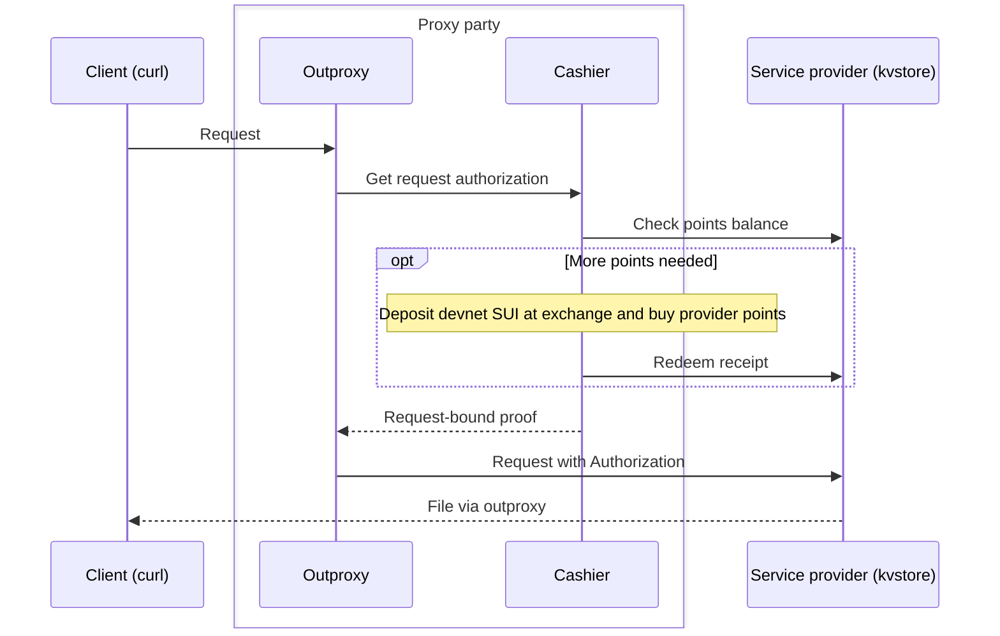

# Quickstart

> [!WARNING]
>
> This quickstart demo uses a public MITM proxy. The service is not trusted. You can play with it or even connect to other providers accepting devnet token. But do not enter sensitive information. [Run your own](../charts/outproxy-with-faucet/README.md) instead if you want to.

<!-- TODO: replace the placeholder domains outproxy.paid-services.com and kvstore.paid-services.com with the public demo domains before publishing. -->

In this guide, you will download a small text file from a PAID blob storage service. You will learn that:

- PAID services are open: anyone with payment can access public content, without a per-user ACL or captcha. Bots can access it too.
- PAID services are easy to use: ordinary HTTP clients can access them through a proxy by setting an environment variable.

PAID services meter your requests and charge for what you use. For this demo, the shared proxy pays on your behalf, so you do not need to set up a wallet. The proxy and its cashier use the same architecture you can run yourself to access PAID services with SUI devnet funds.

## Download a text file in one command

With `curl` and `jq` installed, run:

```bash
http_proxy=http://outproxy.paid-services.com:8080 curl --fail-with-body -sS --noproxy '' \
  -H 'content-type: application/json' -H 'x-request-id: quickstart-read-http' \
  -d '{"key":"bafkreihfqce2w5fkfwct23alewvtt56pwg7yzeayg4tfhjme57ie44qbam"}' \
  http://kvstore.paid-services.com/kvstore.v1.MeteredStorageService/GetCASValue \
  | jq -er .value | base64 -d
```

```text
Welcome, PAID user!
```

The key is the real content identifier (CID) of the text file, including its final newline. The service returns the bytes as base64 in the JSON `value` field. `jq -r` removes the JSON quotes before decoding. Curl requires lowercase `http_proxy` for HTTP requests; `--noproxy ''` ensures it uses the proxy.

## Download over HTTPS

The first command uses plain HTTP. To use HTTPS, download the demo proxy's CA certificate and trust it for this request:

```bash
HTTPS_PROXY=https://outproxy.paid-services.com:8443 curl --fail-with-body -sS --noproxy '' \
  --cacert <(curl --fail-with-body -sS https://outproxy.paid-services.com/ca.crt)> \
  -H 'content-type: application/json' -H 'x-request-id: quickstart-read-https' \
  -d '{"key":"bafkreihfqce2w5fkfwct23alewvtt56pwg7yzeayg4tfhjme57ie44qbam"}' \
  https://kvstore.paid-services.com/kvstore.v1.MeteredStorageService/GetCASValue \
  | jq -er .value | base64 -d
```

```text
Welcome, PAID user!
```

Outproxy uses TLS interception to attach the authorization header. Trusting its CA lets it read the requests you send through it. The proxy URL remains `http://`: curl uses HTTP CONNECT, then establishes TLS for the HTTPS target. Obtain the CA through the demo's trusted HTTPS certificate download.

Everyone using this demo shares the proxy's account and balance. Cashier automatically obtains devnet funds when needed; initial funding may take a few seconds. If a request fails during funding or a devnet outage, try again shortly. When running your own proxy, your cashier manages your own funds.

## What happens behind the scenes

The storage provider keeps the file in content-addressed blob storage and charges for reads. The proxy and cashier act as one paying party:

1. Curl sends its request through outproxy.
2. Cashier checks that party's points balance at the provider.
3. If more points are needed, cashier uses a funded SUI devnet wallet to deposit at the provider's chosen exchange, buy provider points, and redeem the receipt at the provider's account service.
4. Cashier returns a proof bound to the request's method and URL. Outproxy attaches it as the authorization header and forwards the request.
5. The provider meters the request, deducts points, and returns the file.



The same proxy approach works for blackbox clients such as `curl` and `wget`. If you control the application code, use an interceptor to attach cashier proofs directly, without TLS interception. You still need a trusted cashier to manage funding.

## Next steps

- [Getting started](./client-guide/getting-started.md): run your own services.
- [Client authentication](./client-guide/client-auth.md): understand request authorization.
- [Outproxy](./client-guide/outproxy.md) and [cashier](./client-guide/cashier.md): manage your own access and funds.
- [Exchange](./concepts/exchange.md): learn how provider points work.
