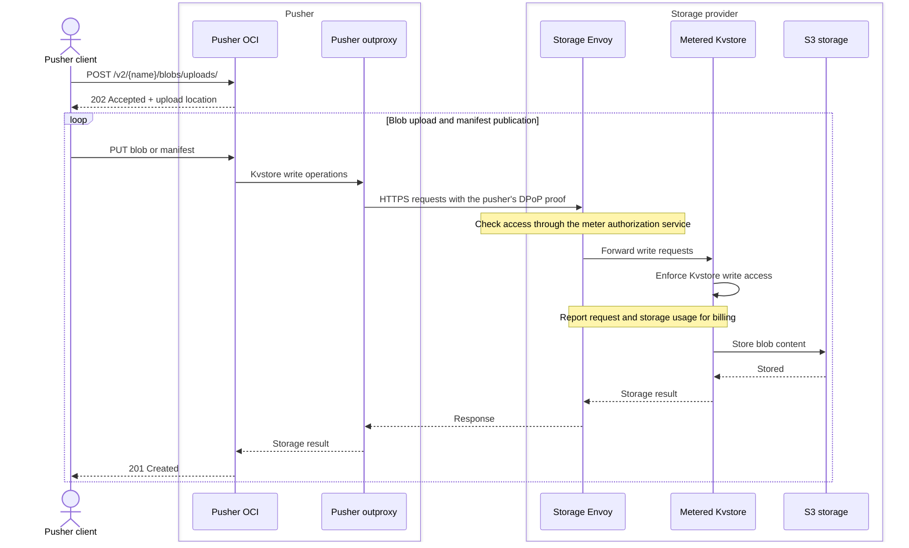
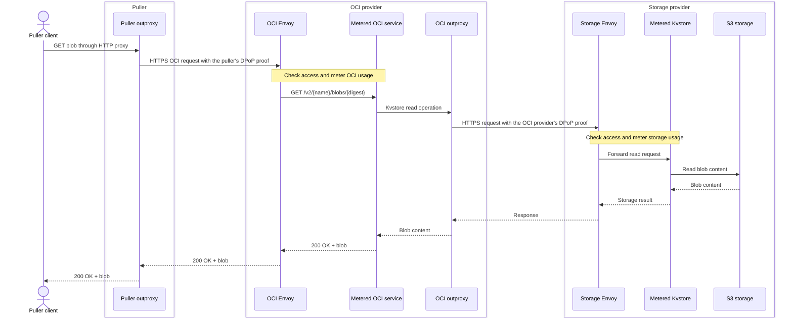

# OCI push and pull

The OCI flow involves four parties: a pusher, a puller, an OCI provider, and a storage provider. The pusher publishes content through its own OCI service; the puller retrieves it through the OCI provider.

- Pusher
  - Client POST/PUT -> Pusher OCI -> Pusher outproxy -> Storage provider
    - Pusher runs its own OCI because the converted write request to Kvstore must use its own outproxy for write access control
- Puller
  - Client GET -> Puller outproxy -> OCI provider
- OCI provider
  - Envoy -> Metered OCI service -> Outproxy -> Storage provider
    - Metered OCI service includes `applications/oci`, the resource-specific metering for OCI request converter
- Storage provider
  - Envoy -> Metered Storage service -> S3
    - Metered storage service includes `infrastructure/cmd/kvstore`, the resource-specific metering for storage

## Push

The pusher needs a funded account with the storage provider.
The client starts a blob upload with POST, then uploads the blob and manifest
with PUT. The pusher's OCI service converts these into Kvstore operations.

## Pull

The puller needs a funded account with the OCI provider. The OCI provider
needs a funded account with the storage provider and accesses storage using
its own identity.
The same route serves blob and manifest GET requests. The diagram shows a
blob read; manifest reads also resolve tag and anchor metadata in Kvstore.

Alternatively, the puller can run its own OCI application or use an OCI library in its browser to access the storage provider directly. This avoids relying on a separate OCI provider and paying its metering charges, but requires the puller to manage the application and storage access.
